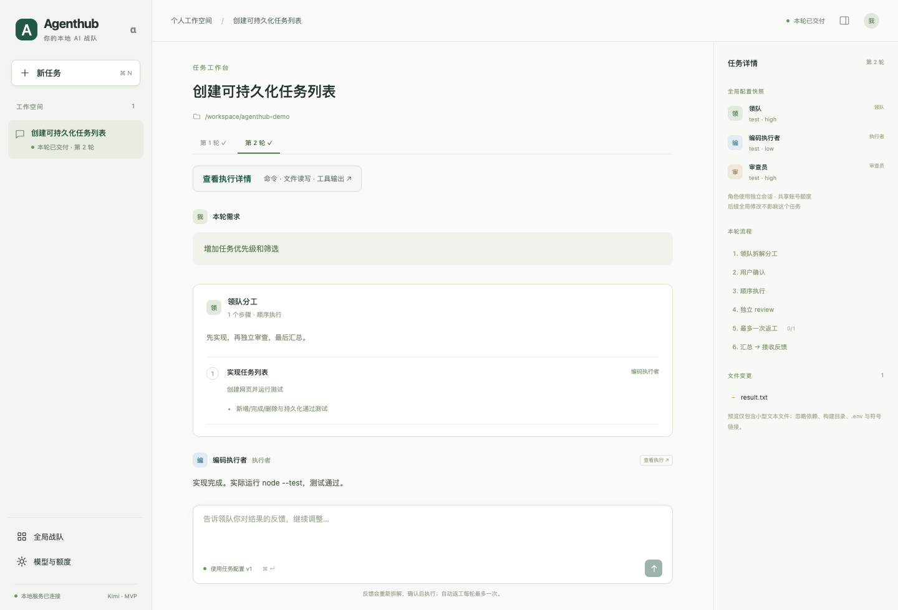
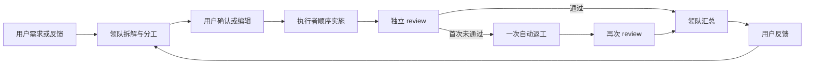
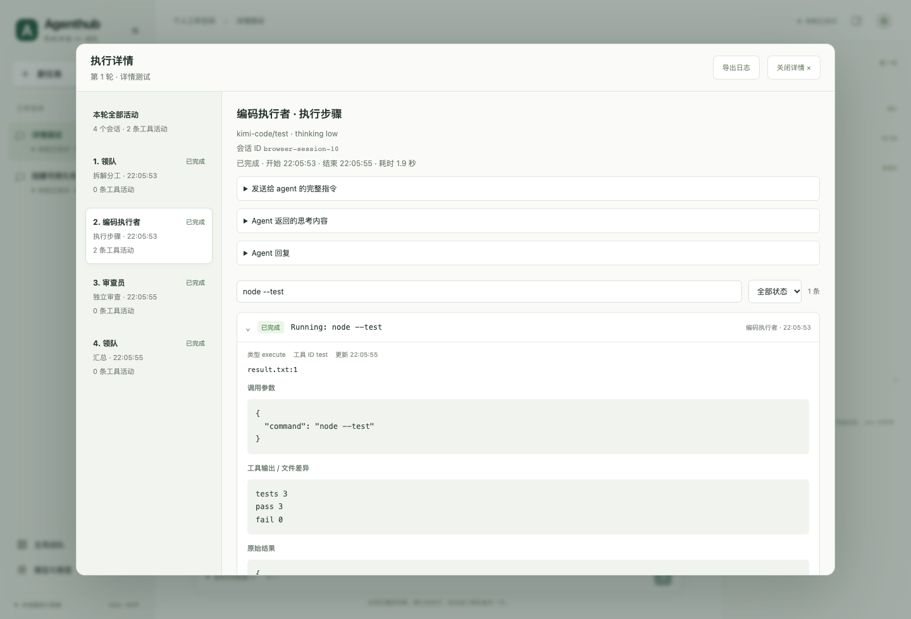

# Agenthub

**把本地 coding agent 组成一支可配置、可确认、可追踪的 AI 战队。**

[English](README.en.md) · [后续 TODO](TODO.md) · [贡献指南](CONTRIBUTING.md) · [架构](docs/architecture.md) · [验证说明](docs/testing.md) · [MIT](LICENSE)

Agenthub 是一个本地服务与网页工作台：领队先理解需求、拆解任务并分配成员，你确认后再执行；实现结束后由独立会话审查，最多自动返工一次，最后汇总结果。你可以继续反馈，在同一任务里开启下一轮。

首版接入 **Kimi Code CLI**。Codex、TRAE、Aiden × Codex、Pi 等适配器属于后续计划，目前没有接入。网页采用桌面工作台布局，方便以后封装 Mac 客户端。



> 截图使用浏览器测试的模拟 agent 数据展示界面，不代表真实模型调用或效果评测。

## 能做什么

- **全局战队配置**：发现本地 Kimi、探测账号可用模型及各模型的 thinking 选项，配置领队、一个或多个执行者及审查员。相同 agent/模型可以用不同 thinking 承担不同角色。
- **资源与建议**：查询账号共享额度、读取有来源的公开模型定位，生成均衡／节省／质量优先建议。推荐采用可编辑的规则，尚无跨模型 benchmark 排名。
- **确认后实施**：查看和编辑领队分工；确认后顺序执行，独立 review，每轮最多自动返工一次，再生成汇总。
- **持续反馈**：结果不满意时直接反馈，再次拆解和确认；每轮需求、分工、审查与交付历史保留。
- **执行可见**：按轮次和 agent 会话查看实时命令、文件读写、工具参数、结果和差异；支持搜索、状态筛选与 JSON 导出。
- **任务配置快照**：任务使用创建时的全局配置。后续修改战队不会悄悄更换已有任务的模型与成员。
- **本地持久化**：SQLite 保存任务、配置和执行记录；浏览器关闭后本地服务继续运行。



## 快速开始

### 环境

- **Node.js 22.13+**，推荐 Node.js 24 LTS；仓库提供 `.nvmrc`。
- 已安装并登录的 **Kimi Code CLI**，目前真实验证版本为 **2.1.1**。需支持 ACP 及模型/thinking 配置；其他版本以实际探测结果为准。
- 本机浏览器。产品当前以 macOS 为主要使用环境；CI 配置覆盖 macOS 与 Linux。Windows 尚未验证。

先按 [Kimi CLI 官方说明](https://github.com/MoonshotAI/kimi-cli)安装并登录，再确认终端可以运行：

```bash
node --version
kimi --version
```

### 安装与启动

```bash
git clone https://github.com/danchaofan/agenthub.git
cd agenthub
npm ci
npm run build
npm run dashboard
```

打开 **http://127.0.0.1:4317**。`dashboard` 启动后台服务并打印地址；重复运行会返回已有服务地址。从源码运行即可，目前不发布 npm 安装包或 Mac 安装包。

```bash
npm run status      # 查询服务状态
npm run stop        # 停止后台服务
npm run dev         # 前台开发服务，网页支持热更新
```

也可使用 `./scripts/agenthub.sh dashboard`。脚本只使用 PATH 中的兼容 Node；可通过 `AGENTHUB_NODE` 指定 Node 可执行文件，不依赖某台机器的私有运行时。

### 第一个任务

1. 打开工作台，探测 Kimi；未自动找到时填写可执行文件路径。
2. 同步模型与额度，生成建议，编辑成员名称、模型、thinking 与职责描述，保存全局战队。
3. 选择一个**已存在的项目绝对路径**，填写需求并提交。领队分析本身会调用模型。
4. 查看或编辑分工，点击「确认分工并执行」。
5. 在「查看执行详情」中查看活动，在右侧查看文件变更；交付后通过输入框继续反馈。

工作台提供一个任务列表示例需求。新安装的验收目录位于 `.agenthub/acceptance-project/`，与仓库内已完成的示例源码分开。也可以自己创建空目录，然后提出需求：

```text
创建一个中文任务列表网页，支持新增、完成、删除、状态筛选和刷新后保留。
使用原生 HTML/CSS/JavaScript，业务逻辑独立为模块。
编写并实际运行 node:test 测试，提供 README。保留已有文件，不提交或发布。
```



## 执行权限与恢复

默认对应 Kimi 的 **Ask When Needed**（ACP `auto`）。执行者可以按 CLI 的原生规则编辑文件、运行命令；需要审批或回答问题时，原生选项转发到工作台。也可以在全局配置中选手动审批。ACP `yolo` 不作为默认模式。

领队和审查员使用独立会话及只读工具列表，限制为 `Read/Grep/Glob`；原生分工／计划工具由外层调度替代。角色独立会话可以减少共享上下文干扰，但同一账号的额度仍共享。

取消保留已经产生的文件改动。服务意外重启后，活动任务标记为中断，不自动重放命令；检查现有产物后反馈并重新确认。CLI 通过桥接进程绑定服务连接，连接断开时清理 CLI 进程组。同一项目及其父子目录不能被两个任务同时实施。

工具限制不是操作系统沙箱，CLI 仍使用本地用户权限及其环境配置。确认分工前应检查项目和范围。更多信息见 [SECURITY.md](SECURITY.md)。

## 配置与数据

| 环境变量             | 默认值／用途                                                       |
| -------------------- | ------------------------------------------------------------------ |
| `AGENTHUB_PORT`      | `4317`，仅绑定 `127.0.0.1`                                         |
| `AGENTHUB_DATA_DIR`  | 仓库根目录下的 `.agenthub/`；同一数据目录只允许运行一个服务        |
| `AGENTHUB_NODE`      | 仅供 shell 启动脚本使用，指定兼容 Node 的可执行文件                |
| `AGENTHUB_CHROME`    | 可选，用于测试／截图的 Chrome 或 Chromium 可执行文件               |
| `KIMI_CODE_HOME`     | Kimi 配置和凭据目录，默认用户 home 下的 `.kimi-code/`              |
| `KIMI_CODE_BASE_URL` | 额度接口基础地址，默认 `https://api.kimi.com/coding/v1`            |
| `AGENTHUB_URL`       | 真实验收／历史截图脚本连接的服务地址，默认 `http://127.0.0.1:4317` |
| `AGENTHUB_TASK_ID`   | 可选，真实验收续做或历史截图选择的任务 ID                          |

环境变量由 shell 传入，不自动加载 `.env`。例如：

```bash
AGENTHUB_PORT=4320 AGENTHUB_DATA_DIR=./.agenthub-demo npm run dashboard
```

运行数据包含全局配置、任务快照、需求、指令、会话输出、审批记录及文件预览，保存在 `.agenthub/`；新建运行目录／数据库权限分别为 700／600。服务校验 Host、Origin 和 JSON 请求类型，停止接口另需本地随机令牌。当前没有远程部署、多用户登录或云同步。

额度查询读取 Kimi 自己维护的现有登录凭据，调用其 `/usages`；不把 access token 发给前端，也不保存到 Agenthub 数据库。不负责刷新凭据；过期时先在 Kimi 终端更新登录态。额度未知不会按零处理；刷新失败保留旧窗口并标注过期。

`.agenthub/`、测试产物、真实验收导出、环境文件和调研源码档案均被 Git 忽略。日志和项目文件可能含敏感内容，分享前需自行检查。

## 开发与测试

```bash
npm ci
npm run dev
```

自动测试使用隔离的模拟 runner 和 ACP CLI，不需要 Kimi 登录，不消耗模型额度：

```bash
npm run format        # 统一代码格式
npm run check         # 类型、格式和开源发布文件检查
npm run build
npm test

# macOS 可自动使用已安装 Chrome；其他环境安装 Playwright Chromium
npx playwright install chromium
npm run test:browser

# 仓库内已完成的任务列表示例
npm run test:example
npm run test:example-browser
```

真实 Kimi 验收为单独的显式操作，会使用账号额度、确认验收计划并修改验收项目：

```bash
npm run dashboard
npm run test:live
```

该脚本只对识别为只读或验收范围内的原生请求批准一次；遇到其他请求会停下，保留任务供用户处理，不给予整个会话授权。验收证据写入被忽略的 `artifacts/`。不要在 CI 中运行真实模型验收。

验证范围和真实试跑中的发现见 [docs/testing.md](docs/testing.md)。示例测试或审查通过不代表模型不会漏项；结果仍需可靠的验收证据。

## 目录与扩展

```text
server/                 HTTP API、ACP 桥接、资源探测、状态机和 SQLite
  agents/               只读／执行者的 Kimi agent 定义
web/src/
  App.tsx               工作台装配与任务交互
  components/           分工、审批、审查结果和基础 UI
  pages/                全局战队、模型与额度设置
  lib/                  API 客户端和显示文案
scripts/                启停、验收、截图和发布检查
  lib/                  共享浏览器配置
test/                   数据、API、ACP、状态机与浏览器测试
examples/kimi-acceptance/ 已完成的任务列表示例与独立测试
docs/                   架构、调研、验证和模拟数据截图
```

新增 agent 通过 `server/types.ts` 的 `AgentRunner` 接口接入；流程编排由 `server/engine.ts` 管理。浏览器只和本地服务通信，便于未来复用到桌面客户端。参见 [架构说明](docs/architecture.md)和[贡献指南](CONTRIBUTING.md)。

## 当前边界与后续方向

后续工作按“Kimi 使用体验完善 → 多 agent 接入 → 战队推荐增强 → Mac 客户端”推进。优先级、待办项和验收标准见 [TODO.md](TODO.md)。

- 当前只接入 Kimi；其他 coding agent 和 Mac 客户端属于后续计划。
- 推荐是规则建议，尚无跨模型评测、真实成本学习或跨账号额度调度。
- 执行详情采用 ACP 结构化活动，尚未提供原始 PTY 终端回放。
- 文件预览只覆盖小型文本文件：最多 1000 个文件，单文件 256 KB，单侧预览 50 KB；忽略 `.env`、依赖、构建目录、二进制和符号链接。它不是完整 Git diff 或备份。
- 旧执行记录只显示当时采集的内容；新会话才记录完整指令、参数和耗时。长输出会明确标注截断。

## 致谢与许可

思路受到 [botmux](https://github.com/deepcoldy/botmux) 的 coding agent 桥接、执行可见性和权限处理启发；本地资源发现与额度查询参考了 [Orca](https://github.com/stablyai/orca)。项目通过 ACP 调用独立安装的 [Kimi Code CLI](https://github.com/MoonshotAI/kimi-cli)，不捆绑其程序。

Agenthub 使用 [MIT License](LICENSE)。第三方依赖及参考项目保留各自许可，见 [THIRD_PARTY.md](THIRD_PARTY.md)。
