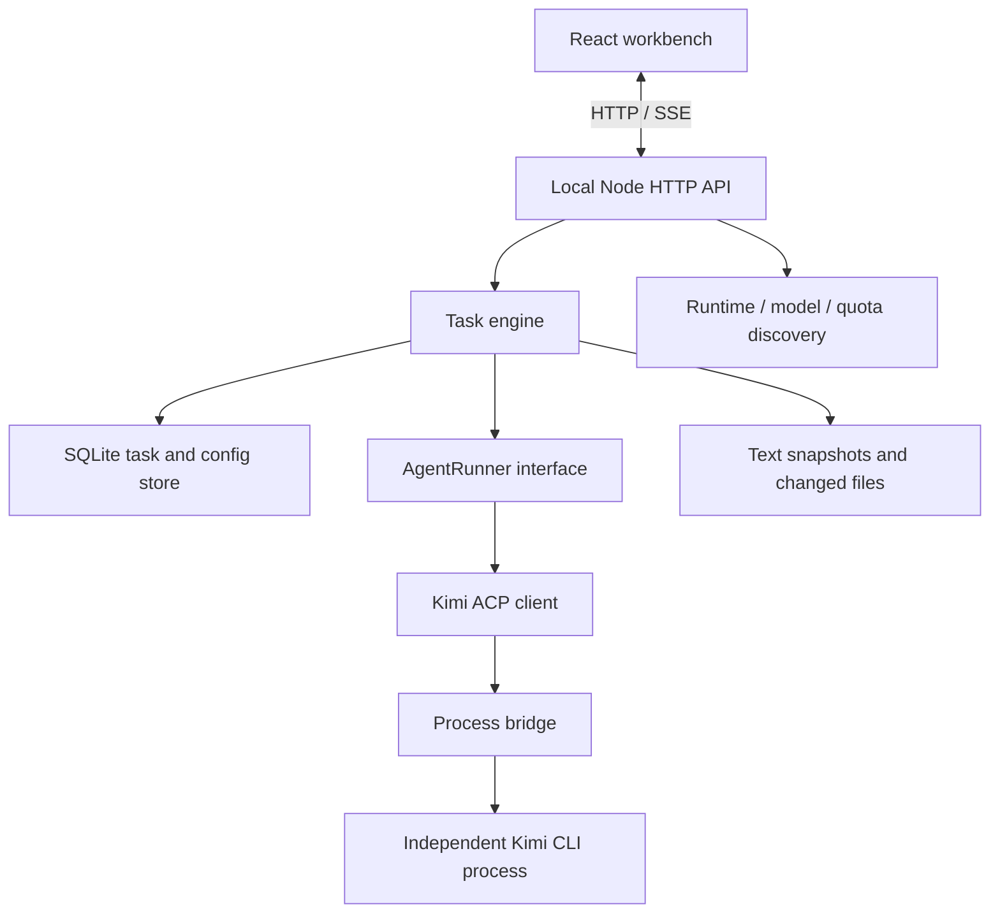

# Architecture

Agenthub keeps orchestration in a local service and interaction in a React client. The web client never launches agent processes or reads credentials directly.

## Runtime ownership

| Module                   | Responsibility                                                                         |
| ------------------------ | -------------------------------------------------------------------------------------- |
| `server/main.ts`         | Startup, loopback binding, service lease, runtime paths and shutdown                   |
| `server/http.ts`         | API validation, local-origin checks, SSE notifications and web serving                 |
| `server/engine.ts`       | Workflow state, confirmation, project locks, native inputs and stream persistence      |
| `server/acp.ts`          | JSON-RPC lifecycle, dynamic option application, prompt streaming and cancellation      |
| `scripts/acp-bridge.mjs` | Pipe/process-group ownership; terminate CLI children when the parent connection closes |
| `server/resources.ts`    | Local discovery, sourced model notes, quota parsing and profile recommendations        |
| `server/store.ts`        | SQLite WAL, configuration versions, task history and interrupted-task recovery         |
| `server/artifacts.ts`    | Canonical paths, bounded text snapshots and file-change previews                       |
| `server/permissions.ts`  | Conservative read-only operation recognition                                           |
| `server/types.ts`        | Shared contracts and Zod boundary validation                                           |

The HTTP service serves the production build or Vite middleware in development. SSE signals a change; the client fetches current state. Tool updates merge by invocation and tool-call ID, with 250 ms persistence batching and immediate flush at invocation boundaries.

## Workflow invariants

1. Every task receives a deep copy of the current global configuration.
2. Planning may call a model and inspect files, but workers start only after explicit plan confirmation.
3. Plans assign only configured worker profiles, with unique step IDs.
4. Workers execute sequentially against the same project. Parent/child project paths share an execution lock.
5. Reviewer and leader invocations use independent read-only sessions.
6. Each round permits at most one automatic rework, followed by another review and a summary. A failed second review remains visible.
7. User feedback creates a new round without changing the task's configuration snapshot.
8. Cancellation and failures retain already-written files; restart recovery never replays commands automatically.

Review currently inspects code and reported test evidence; its read-only tool allowlist does not execute tests. Worker test results and independent verification must remain distinguishable. A model's successful review is not a substitute for reliable tests.

## Persistence and privacy

SQLite stores task rounds, configuration snapshots, logs, pending requests, review history and bounded text diffs. Prompts and tools are stored with their invocation/session association. Native input answers remove the active pending request; sensitive form values are not included in audit messages.

The data directory defaults to `.agenthub/` and holds the database, service record, log and an isolated acceptance project. Account tokens are owned by Kimi and only read for the existing quota API. The UI receives quota windows and discovery metadata, never those tokens.

## Adapter extension

Implement `AgentRunner.run` to supply a session ID, stream messages/tool activities, forward native inputs and return final text. Honor `AbortSignal`, native configuration choices and completion status. Keep adapter processes tied to service lifecycle, and add protocol/cancellation tests before exposing a new agent in the setup UI.

Additional adapters also need runtime/model/effort discovery and clearly sourced quota support; unsupported or unavailable information must remain unknown. Model identities and shared account quota pools must not be inferred from similar names.

## UI layout

`web/src/App.tsx` owns task selection and the workbench. Configuration/resource screens live in `pages/`; plans, review results, native forms and icons live in `components/`; API contracts and labels live in `lib/`. `ExecutionDetails.tsx` renders the bounded session/tool inspector. This keeps the web UI reusable for a future desktop shell without moving local process ownership into the browser.
