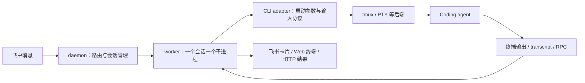

# botmux 基础调研：agenthub 的可复用基础

调研日期：2026-10-11（Asia/Shanghai）。范围：下载源码，阅读架构、配置、目标 CLI 适配器、HTTP 控制入口和工作流实现；尚未安装依赖、构建或调用真实模型。

## 1. 下载结果与结论

- 上游：[deepcoldy/botmux](https://github.com/deepcoldy/botmux)，分支 `master`。
- 本地源码：[botmux](https://github.com/deepcoldy/botmux/tree/ff803e6bc3c81fe700799cdf8cf2d1819965016b)。
- 快照提交：`ff803e6bc3c81fe700799cdf8cf2d1819965016b`，来自 GitHub 源码归档的 PAX 元数据。
- 下载方式：完整 Git 克隆、浅克隆均遇到网络失败，随后通过 GitHub 官方 codeload 下载并解压成功。当前是源码快照，**没有 `.git` 和提交历史**，不能直接 `git pull`。
- 固定快照：[上游源码](https://github.com/deepcoldy/botmux/tree/ff803e6bc3c81fe700799cdf8cf2d1819965016b)。
- 技术栈：TypeScript；Dashboard 用 React；包含 Electron 桌面目录；源码开发要求 Node ≥22、Bun 1.4.2，使用 `bun.lock`。依赖涉及飞书 SDK、xterm、WebSocket、node-pty 等。
- 上游声明 MIT，许可证保留在 [LICENSE](https://github.com/deepcoldy/botmux/blob/ff803e6bc3c81fe700799cdf8cf2d1819965016b/LICENSE)。

**判断：值得作为 agenthub 的执行层和工作流参考。** 它已经解决多种 CLI 的启动、输入、会话和输出桥接，也有角色／能力描述与任务编排。但你的“固定 leader 接收所有用户指令，依据预配置执行者进行分工”仍需 agenthub 自己组织成统一产品流程。

## 2. 运行架构

普通飞书模式大致为：

普通部署每个 bot 一个 daemon，一个 daemon 管理多个会话。CLI adapter 和进程后端是不同层：前者知道 agent 的参数、输入与恢复语义；后者负责进程、终端及存活。tmux 可以保留真实 CLI 进程，供 worker 重新连接。

输出也有不同通道：终端内容用于显示执行过程；结构化 transcript 或 app-server 协议用于识别轮次、采集最终回答；部分适配器依赖注入提示让模型调用 `botmux send`。因此“能启动 CLI”“能显示终端”“能可靠拿到任务最终结果”要分别验证。

关键入口：

| 源码                                                                                                                                                                                                                                                             | 作用                                       |
| ---------------------------------------------------------------------------------------------------------------------------------------------------------------------------------------------------------------------------------------------------------------- | ------------------------------------------ |
| [daemon.ts](https://github.com/deepcoldy/botmux/blob/ff803e6bc3c81fe700799cdf8cf2d1819965016b/src/daemon.ts)                                                                                                                                                     | 路由、IPC、恢复及各服务组装                |
| [worker.ts](https://github.com/deepcoldy/botmux/blob/ff803e6bc3c81fe700799cdf8cf2d1819965016b/src/worker.ts)                                                                                                                                                     | CLI 启动、输入输出、终端及 transcript 集成 |
| [CLI 接口](https://github.com/deepcoldy/botmux/blob/ff803e6bc3c81fe700799cdf8cf2d1819965016b/src/adapters/cli/types.ts#L127)／[注册表](https://github.com/deepcoldy/botmux/blob/ff803e6bc3c81fe700799cdf8cf2d1819965016b/src/adapters/cli/registry.ts)           | CLI 能力与适配器选择                       |
| [backend 目录](https://github.com/deepcoldy/botmux/tree/ff803e6bc3c81fe700799cdf8cf2d1819965016b/src/adapters/backend)                                                                                                                                           | tmux、PTY 等执行后端                       |
| [session-manager.ts](https://github.com/deepcoldy/botmux/blob/ff803e6bc3c81fe700799cdf8cf2d1819965016b/src/core/session-manager.ts)／[worker-pool.ts](https://github.com/deepcoldy/botmux/blob/ff803e6bc3c81fe700799cdf8cf2d1819965016b/src/core/worker-pool.ts) | 会话上下文与 worker 生命周期               |
| [trigger-session.ts](https://github.com/deepcoldy/botmux/blob/ff803e6bc3c81fe700799cdf8cf2d1819965016b/src/core/trigger-session.ts)                                                                                                                              | HTTP 任务转成新会话或已有会话的一轮输入    |

## 3. 你常用的五种 CLI

下表表示本次快照中的**代码接入情况**，不是本机端到端验证结果。

| 用户选择      | botmux 映射                                    | 模型配置                                     | thinking 配置                                                                                       | 结果／恢复与工作流要点                                                                  |
| ------------- | ---------------------------------------------- | -------------------------------------------- | --------------------------------------------------------------------------------------------------- | --------------------------------------------------------------------------------------- |
| traecli       | `cliId: traex`；默认查找 `traex` 可执行文件    | 传 `--model`                                 | 传 `-c model_reasoning_effort=...`；档位依模型校验                                                  | 有 transcript；本次源码的内置 v3 工作流允许 `traex`                                     |
| aiden x codex | `cliId: codex` + `wrapperCli: "aiden x codex"` | 复用 Codex 模型启动路径                      | wrapper 有专用 shim，避免 reasoning 参数被网关吞掉                                                  | 复用 Codex 桥接；仍需真实网关登录和参数兼容验证                                         |
| codex         | `cliId: codex`                                 | 传 `--model`                                 | 传进程级 `model_reasoning_effort`                                                                   | transcript／可选 RPC；内置 v3 允许；另有 `codex-app` 的 app-server 路径                 |
| pi            | `cliId: pi`                                    | **代码已传 `--model`**，没有内置模型候选列表 | 本次适配器没有消费通用 `reasoningEffort`                                                            | 有 JSONL 桥与轮次扩展；内置 v3 不允许 Pi                                                |
| kimi          | `cliId: kimi`                                  | 传 `--model`                                 | 代码仅对 `kimi-code/k3`、`kimi-code/k3-256k` 开放 `low/high/max`，注入 `KIMI_MODEL_THINKING_EFFORT` | 没有同等结构化最终回复桥；原生会话 ID 捕获缺失，重启后可能新开会话；内置 v3 不允许 Kimi |

证据：[TRAE 选择及别名](https://github.com/deepcoldy/botmux/blob/ff803e6bc3c81fe700799cdf8cf2d1819965016b/src/setup/cli-selection.ts#L87)、[TraeX adapter](https://github.com/deepcoldy/botmux/blob/ff803e6bc3c81fe700799cdf8cf2d1819965016b/src/adapters/cli/traex.ts#L217)、[Aiden × Codex 映射](https://github.com/deepcoldy/botmux/blob/ff803e6bc3c81fe700799cdf8cf2d1819965016b/src/setup/cli-selection.ts#L63)、[wrapper 参数处理](https://github.com/deepcoldy/botmux/blob/ff803e6bc3c81fe700799cdf8cf2d1819965016b/src/setup/cli-selection.ts#L558)、[Codex 参数](https://github.com/deepcoldy/botmux/blob/ff803e6bc3c81fe700799cdf8cf2d1819965016b/src/adapters/cli/codex.ts#L390)、[Pi 模型参数](https://github.com/deepcoldy/botmux/blob/ff803e6bc3c81fe700799cdf8cf2d1819965016b/src/adapters/cli/pi.ts#L109)、[thinking 能力表](https://github.com/deepcoldy/botmux/blob/ff803e6bc3c81fe700799cdf8cf2d1819965016b/src/services/codex-reasoning-effort.ts)、[Kimi 环境注入](https://github.com/deepcoldy/botmux/blob/ff803e6bc3c81fe700799cdf8cf2d1819965016b/src/worker.ts#L17660)、[Kimi 恢复缺口](https://github.com/deepcoldy/botmux/blob/ff803e6bc3c81fe700799cdf8cf2d1819965016b/src/adapters/cli/kimi.ts#L40)、[结构化桥接清单](https://github.com/deepcoldy/botmux/blob/ff803e6bc3c81fe700799cdf8cf2d1819965016b/src/services/structured-bridge-clis.ts#L25)。

三个容易踩的点：

1. `aiden` 原生 agent 和 `aiden x codex` 是不同选项；后者应使用 Codex adapter，不能简单配成 `cliId: aiden`。
2. `traecli` 是选择别名，adapter 默认执行的是 `traex`；只有 `traecli` 的机器需要明确指定执行路径。
3. 产品不能把 thinking 下拉做成所有 CLI 都相同的固定六档。应根据 CLI、模型和实际接入路径显示可用项，不能让用户保存一个随后被忽略的配置。

官网部分页面落后于本次源码：文档模型表未标出 Pi 的 `--model`；工作流限制仍只列三款 CLI，而源码白名单已是 `claude-code/codex/seed/traex/relay`；Kimi thinking 也已出现在代码中。本报告以上述源码为准，真实运行仍待验证。

## 4. 与 leader／“苦力强”设想的对应

| 你的需求                              | 上游已有基础                                             | agenthub 需要补齐                                                 |
| ------------------------------------- | -------------------------------------------------------- | ----------------------------------------------------------------- |
| leader 选择 CLI、模型、thinking       | BotConfig 与 CLI selection；同 CLI 多个 bot 可配不同模型 | 固定 leader 的配置引用；所有指令先进入 leader 的产品路由          |
| 同 agent 不同模型／强度作为多个执行者 | 多 bot 配置及独立会话；工作流的执行配置快照              | 独立 `profileId`，允许多个 profile 指向同一个 CLI/runtime         |
| “token 充足，负责简单编码”等描述      | Role 与 capability 花名册，供模型了解谁擅长什么          | 把描述和执行参数绑定；提供完整名单给 leader；输出可执行的分配结果 |
| 拆解、分工、review、返工              | dispatch/report；v3 architect、DAG、并发、loop/revisit   | leader 的选择策略、结果汇总、统一任务状态与界面                   |
| 不通过飞书，自用产品直接操作          | core-only HTTP 模式；独立 workflow-core 包               | agenthub 的配置存储、执行器桥接、任务界面和生命周期管理           |

建议把“描述”和“执行提示”分开：前者给 leader 做选择，例如“额度充足、适合中等以下编码”；后者发给执行者定义职责，例如“按验收条件完成实现并报告变更与测试”。“token 充足”在第一版应是用户声明，不能当成系统已查询过的真实剩余额度。

源码：[BotConfig](https://github.com/deepcoldy/botmux/blob/ff803e6bc3c81fe700799cdf8cf2d1819965016b/src/bot-registry.ts#L1495)、[Role resolver](https://github.com/deepcoldy/botmux/blob/ff803e6bc3c81fe700799cdf8cf2d1819965016b/src/core/role-resolver.ts)、[team-roster](https://github.com/deepcoldy/botmux/blob/ff803e6bc3c81fe700799cdf8cf2d1819965016b/src/services/team-roster.ts#L21)、[dispatch/report](https://github.com/deepcoldy/botmux/blob/ff803e6bc3c81fe700799cdf8cf2d1819965016b/src/core/dispatch.ts)、[architect](https://github.com/deepcoldy/botmux/blob/ff803e6bc3c81fe700799cdf8cf2d1819965016b/src/workflows/v3/architect.ts)。

## 5. 两条可以利用的集成路线

### A. 先通过 core-only HTTP 做验证

`botmux serve --api-only` 不需要飞书凭证，绑定 `127.0.0.1`。通过 `/healthz` 等到服务就绪，再调用：

- `POST /api/trigger`：顶层 `instruction` 是任务指令；使用异步应答模式可立即拿到 `sessionId`。
- `GET /api/sessions/:id/trigger-result`：轮询 `running/completed/failed/not_found`，读取 `output.content`。
- `GET /api/sessions/:id/insight`：查看进度。
- 关闭会话、获取可写终端等操作有额外鉴权，不能把所有 localhost 路由当成免签 API。

**限制：** 当前 core-only 每个进程合成一个 bot，CLI 从启动环境读取；它忽略 `bots.json`，且合成配置没有暴露完整 `wrapperCli`／thinking 等 BotConfig 字段。fresh trigger 可对部分 CLI 覆盖模型／thinking，但不是通用的多执行者 profile 服务。Pi 启动时支持模型，不代表 `options.model` 在 trigger 路径同样生效；Kimi 能启动，也不代表 HTTP 能可靠返回最终产出。模型的 trigger 覆盖还只留在内存，重启恢复时可能回到 bot 默认模型。

因此多 CLI／网关／长期 profile 要么管理多个进程并补配置接口，要么进入下一条路线。开发优先级现已由用户确定为 Kimi：先核对 Kimi 原生协议及最终结果采集能力，再验证任务提交、结果采集和取消；不能直接假设现有 core-only 路径已满足 Kimi 闭环。

源码：[core-only 入口](https://github.com/deepcoldy/botmux/blob/ff803e6bc3c81fe700799cdf8cf2d1819965016b/src/index-core-only.ts)、[合成配置](https://github.com/deepcoldy/botmux/blob/ff803e6bc3c81fe700799cdf8cf2d1819965016b/src/bot-registry.ts#L3120)、[trigger 覆盖语义](https://github.com/deepcoldy/botmux/blob/ff803e6bc3c81fe700799cdf8cf2d1819965016b/src/core/trigger-session.ts#L1788)。

### B. 产品阶段评估 workflow-core + agenthub 执行器

仓库已拆出 [packages/workflow-core](https://github.com/deepcoldy/botmux/blob/ff803e6bc3c81fe700799cdf8cf2d1819965016b/packages/workflow-core/README.md)，提供不依赖 daemon／飞书的 DAG、调度、循环、gate、事件及 portable runtime。

宿主注入 `executeAgent`、`resolveExecutionProfile`、产物校验和 gate 处理。执行配置已有 `profileId/executorId/workingDirectory/model/adapterData`，与 leader／多个“苦力强”的 profile 概念接近。thinking、网关与凭证引用可作为 agenthub 的适配数据；凭证本身不应写进持久化的运行快照。

**这不是现成的五 CLI SDK：** 包明确不包含 CLI adapter、PTY／worker 池或 provider executor；仍需自己实现或移植执行桥。其 portable runtime 可由宿主接入自定义执行器，而 botmux 内置 daemon v3 的 CLI 白名单是另一层限制，不能混为一谈。工作流运行要求冻结执行配置，复用同一运行目录时配置漂移会被拒绝。

源码：[portable runtime 依赖](https://github.com/deepcoldy/botmux/blob/ff803e6bc3c81fe700799cdf8cf2d1819965016b/src/workflows/v3/portable-runtime.ts#L78)、[执行 profile 契约](https://github.com/deepcoldy/botmux/blob/ff803e6bc3c81fe700799cdf8cf2d1819965016b/src/workflows/v3/runtime-host-contract.ts#L71)、[内置 v3 CLI 限制](https://github.com/deepcoldy/botmux/blob/ff803e6bc3c81fe700799cdf8cf2d1819965016b/src/workflows/v3/contract.ts#L130)。

**当前建议：** 短期用 core-only 做小范围调用验证；设计 agenthub 时保持自己的 profile／leader／任务模型，进一步评估 workflow-core 和按需复用 CLI 桥接代码。先验证配置、会话隔离与结果可靠性，再决定是否复用整个 daemon。上游源码已经较大，直接整体改造会同时承担飞书、终端、Dashboard 和部署逻辑的维护成本。

## 6. 本机验证范围与后续最小验证

当前下载约 83 MB；源码 `src` 下 1418 个文件、`test` 下 1809 个文件。没有修改上游源码。已核对归档提交、SHA-256 和解压文件一致性，阅读关键实现及相关上游测试；**没有运行构建、上游测试或真实 agent 任务**。

本次 shell 的 PATH 检查：Node 为 `v20.18.0`，低于源码声明的 ≥22；未找到 Bun、tmux、traecli／traex、aiden、pi；找到 Codex 和 Kimi 可执行文件。这里只能说明当前 shell 可见性，不能断言其他路径或环境没有安装，也未验证登录态。

后续最小验证建议：

1. 准备符合要求的独立运行环境，固定当前上游提交。
2. 优先核对本机 Kimi 版本与原生协议，验证模型／thinking、额度、最终输出、会话 ID 和恢复行为；必要时补齐 Kimi 执行桥。
3. 用 Kimi 配置独立 leader／编码／review profile，验证全局配置保存、真实参数生效及上下文隔离。
4. 在真实项目跑通“Kimi leader 拆解分工 → 用户确认 → 编码执行者实现 → reviewer 检查 → leader 汇总”，验证进度、取消和结果持久化。
5. Kimi 闭环通过后再接入 Codex、Aiden × Codex、Trae 和 Pi，具体顺序后续确定。

## 7. 上游参考

- [仓库与固定快照](https://github.com/deepcoldy/botmux/tree/ff803e6bc3c81fe700799cdf8cf2d1819965016b)
- [官方架构](https://deepcoldy.github.io/botmux/architecture.html)
- [CLI 适配器](https://deepcoldy.github.io/botmux/adapters.html)
- [bots.json 配置](https://deepcoldy.github.io/botmux/bots-json.html)
- [角色与团队](https://deepcoldy.github.io/botmux/roles.html)
- [Core-only API](https://deepcoldy.github.io/botmux/api-core-only.html)
- [工作流](https://deepcoldy.github.io/botmux/workflow.html)

网页会随上游更新，能力结论应结合固定快照源码阅读。
